# OSM Fulda – Drucksachen

Druckvorlagen für [OpenStreetMap Fulda](https://wiki.openstreetmap.org/wiki/Fulda), im Stil des
OSM-Fulda-Titelbilds (Schrift *Barlow Condensed*, Textfarbe `#2d3335`). Alles wird aus Skripten gebaut.

Drei Arten, je für eine Situation – am Stand steht vor jedem Stapel ein [Aufsteller](#aufsteller),
der sagt, wofür er da ist:

| | Wofür | Was drauf ist |
|---|---|---|
| [Aushänge](#aushänge) | Schwarzes Brett, Pinnwand, Schaufenster | ein Motiv, **ein** QR-Code zu StreetComplete, Community als Text |
| [Motivkarten](#motivkarten) | zum Liegenlassen: Wartezimmer, Café, Jugendtreff | vorne nur das Motiv, hinten QR-Code zu StreetComplete und Community |
| [Mitmachkarte](#mitmachkarte) | für alle, die schon angebissen haben | sechs QR-Codes: Loslegen, Mehr machen, Mitreden |

Aushänge und Motivkarten gibt es in denselben fünf Motiven, je für eine Zielgruppe: Klassisch (für
alle), Gelb (Politik, Daten), Pixel (Gamer), Pappe (Umwelt, Klima), Sozial (Barrierefreiheit).

## Aushänge

Endformat 137 × 194 mm, zwei pro A4-Bogen, einseitig. Zielgruppen, Regeln und Hintergründe:
[`aushang/README.md`](aushang/README.md).

| Klassisch | Gelb | Pixel | Pappe | Sozial |
|:---:|:---:|:---:|:---:|:---:|
| 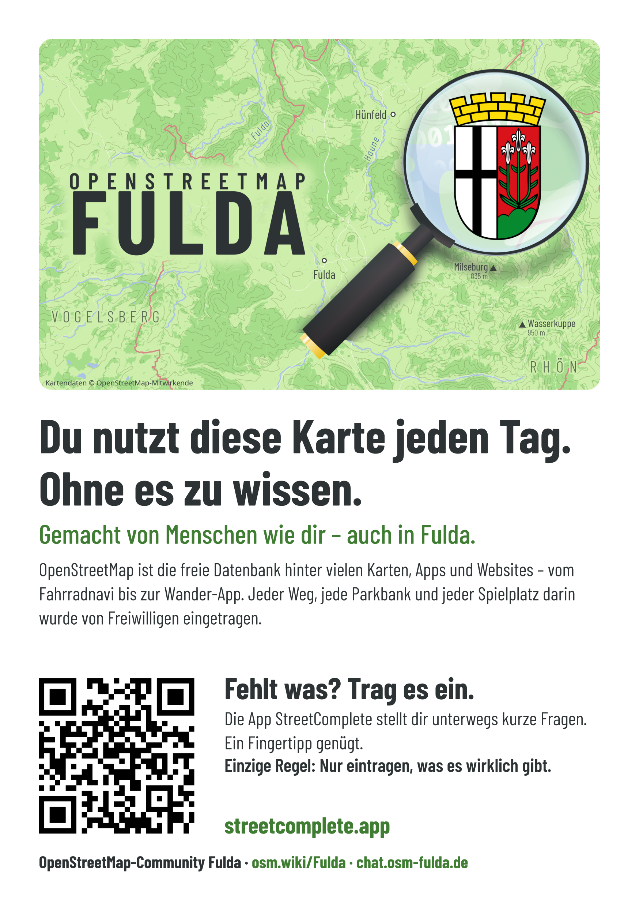 | 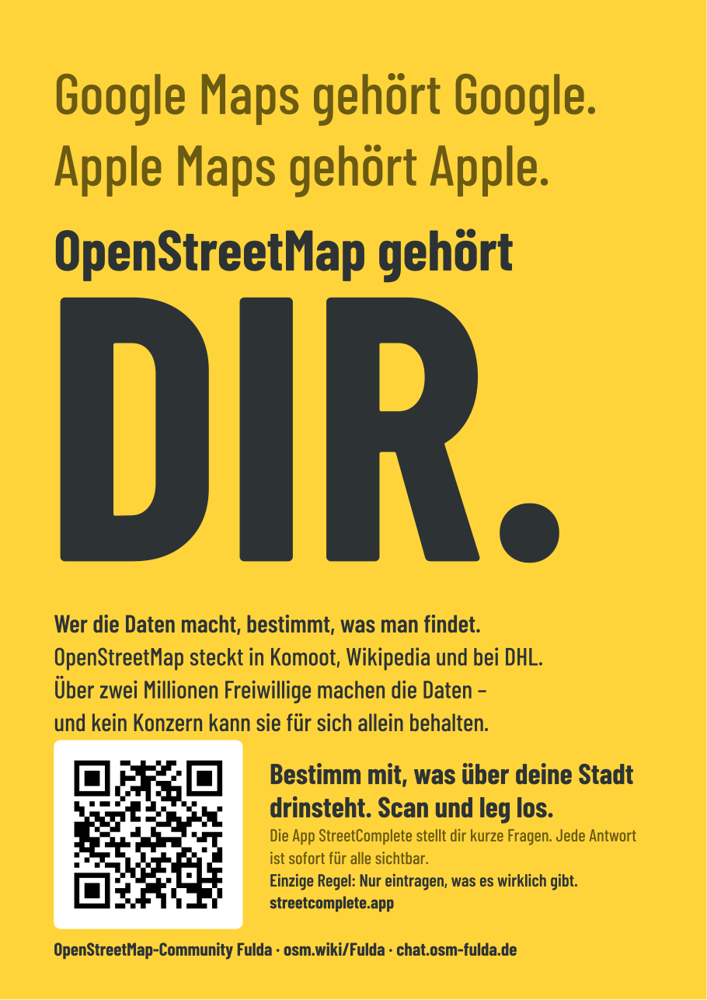 | 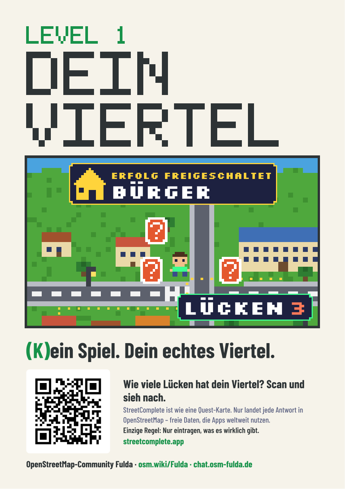 | 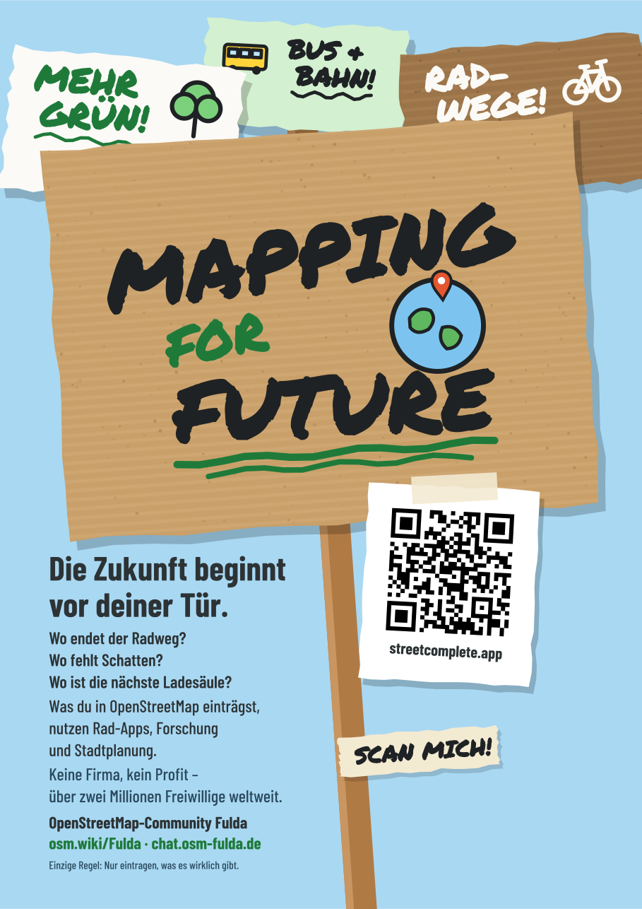 | 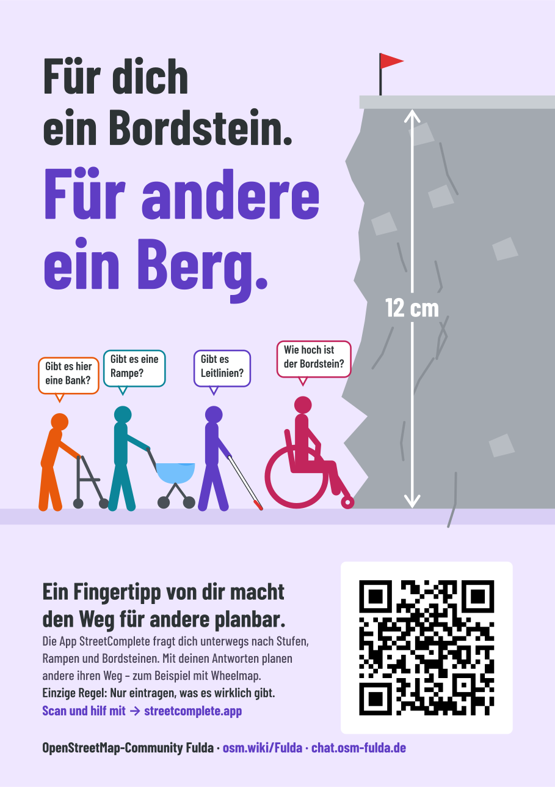 |
| [`a4.pdf`](aushang/aushang-klassisch-a4.pdf) | [`a4.pdf`](aushang/aushang-gelb-a4.pdf) | [`a4.pdf`](aushang/aushang-pixel-a4.pdf) | [`a4.pdf`](aushang/aushang-pappe-a4.pdf) | [`a4.pdf`](aushang/aushang-sozial-a4.pdf) |

Der klassische Aushang hat auf dem Bogen eine zweite Seite: für Glasscheiben beidseitig drucken,
dann ist er von innen und außen lesbar.

## Motivkarten

Visitenkarten 55×85 hochkant, doppelseitig. Vorne nur der Hingucker, hinten für alle gleich:
„Fehlt was? Trag es ein.“, ein QR-Code zu StreetComplete und der Kontakt zur Community.

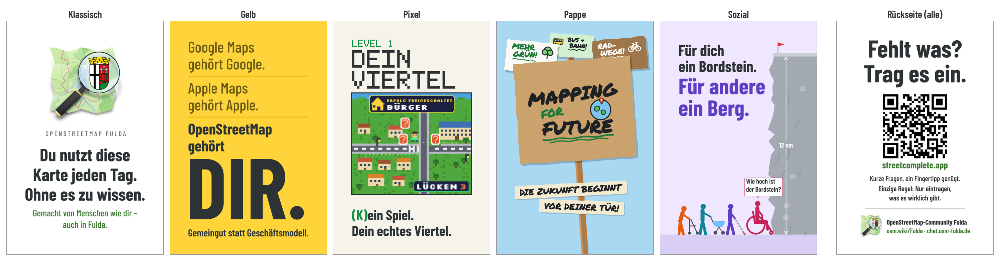

Druckbögen (10 Karten, Seite 2 = Rückseite): [`klassisch`](motivkarten/motivkarte-klassisch-a4.pdf) ·
[`gelb`](motivkarten/motivkarte-gelb-a4.pdf) · [`pixel`](motivkarten/motivkarte-pixel-a4.pdf) ·
[`pappe`](motivkarten/motivkarte-pappe-a4.pdf) · [`sozial`](motivkarten/motivkarte-sozial-a4.pdf)

## Mitmachkarte

| 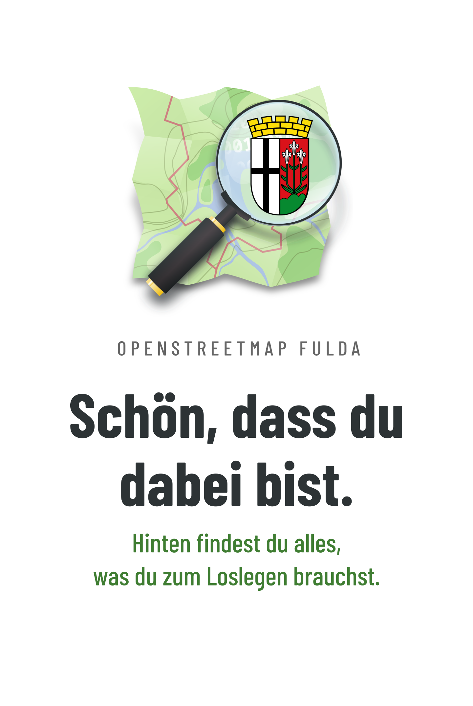 | 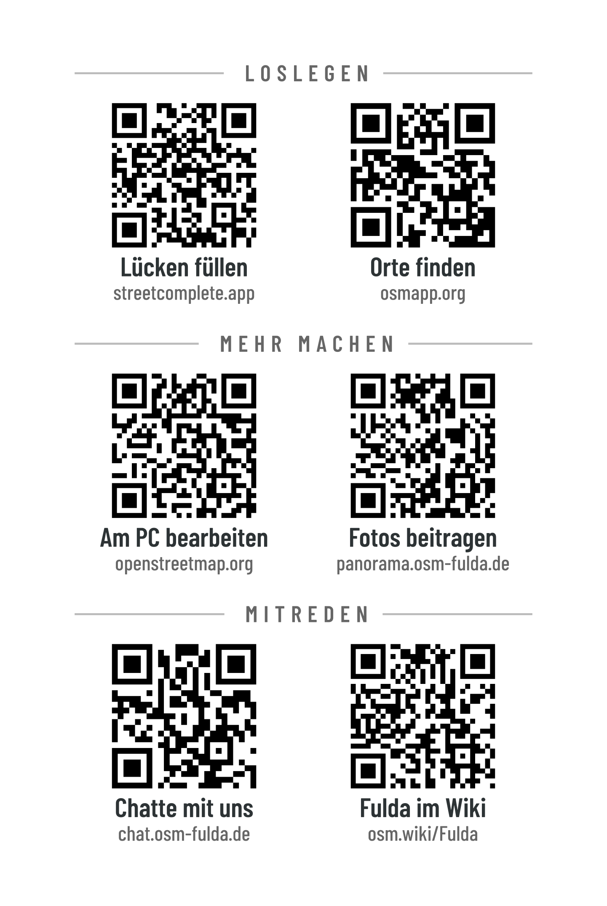 |
|:---:|:---:|

Visitenkarte 55×85 hochkant, doppelseitig, zum Einstecken. Vorne die Begrüßung, hinten sechs
QR-Codes nach dem nächsten Schritt: **Loslegen** (StreetComplete, OSMapp), **Mehr machen**
(am PC auf openstreetmap.org, Fotos mit Panoramax), **Mitreden** (Chat, Wiki Fulda).
Druckbogen: [`mitmachkarte-a4.pdf`](mitmachkarte/mitmachkarte-a4.pdf) (10 Karten).

## Aufsteller

| 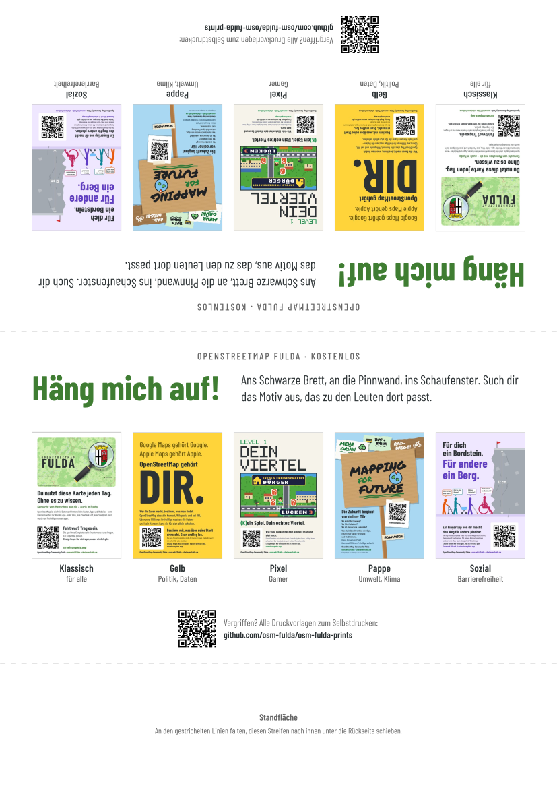 | 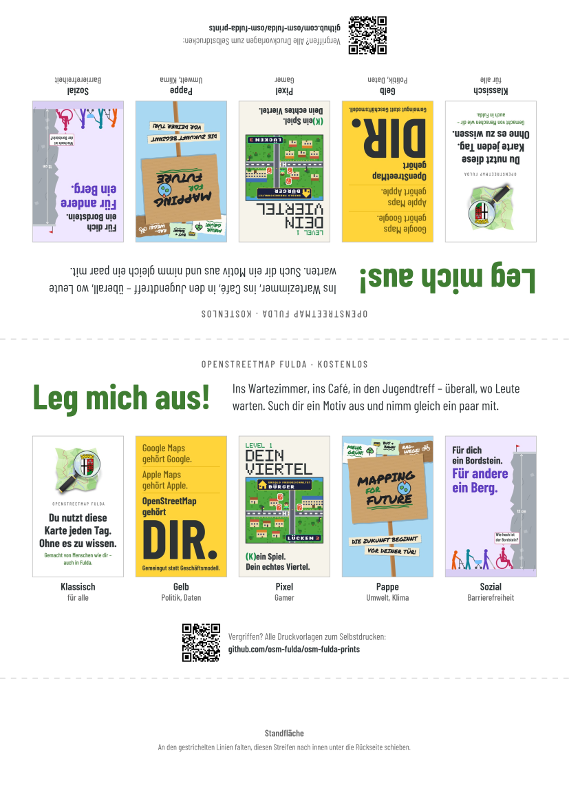 | 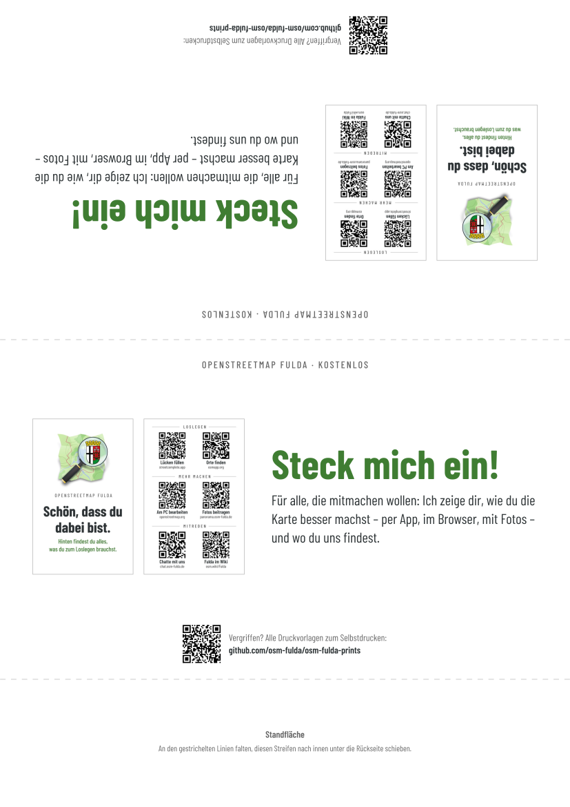 |
|:---:|:---:|:---:|
| „Häng mich auf!“ – alle fünf Aushänge, je mit Zielgruppe | „Leg mich aus!“ – alle fünf Motivkarten, je mit Zielgruppe | „Steck mich ein!“ – Mitmachkarte |

Tischaufsteller A4, zum Dreieck gefaltet, von beiden Seiten lesbar, mit QR-Code zu diesem Repo
(„Vergriffen?“). Alle drei in [`aufsteller-a4.pdf`](aufsteller/aufsteller-a4.pdf) (3 Seiten).

## Merch

| [Shirts](shirt/) |
|:---:|
| 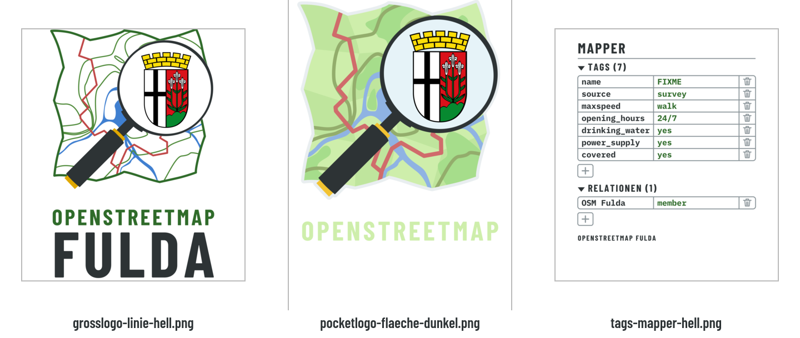 |
| Motive für den DTF-Druck. Details, Druckgrenzen und Daten: [`shirt/README.md`](shirt/README.md). |

`gemeinsam/` enthält, was alle nutzen: `druck.py` (Schrift, QR, Logo, URLs, Hochkant-Karten),
`make_a4.py` (Druckbögen für Karten und Aushänge), Schriften, Logo und Titelbild.

## Bauen

```sh
for f in aushang/make_*.py; do python3 "$f"; done
python3 motivkarten/make_motivkarten.py   # nutzt die Zeichnungen aus aushang/
python3 mitmachkarte/make_mitmachkarte.py
python3 aufsteller/make_aufsteller.py     # zuletzt: nimmt die Vorschaubilder der anderen
shirt/quelle/build.sh                     # braucht zusätzlich ImageMagick (magick)
```

Braucht: Python 3 mit `qrcode`, `fonttools`, `Pillow`; `rsvg-convert` (librsvg); optional `gs`
(Ghostscript – komprimiert die Bögen von ~18 MB auf ~2 MB). Zum Prüfen der Codes: `zbarimg`.
Die Schriften werden aus `gemeinsam/fonts/` geladen, installieren ist nicht nötig.

Texte, Labels und URLs stehen jeweils oben im Skript, gemeinsame URLs in `gemeinsam/druck.py`.
Jedes Skript prüft, dass sich nichts überlagert und alles in die Fläche passt, und bricht sonst ab.

**Achtung:** Die Skripte überschreiben die SVGs. Änderungen am besten im Skript machen; die
Hochkant-Karten liegen auf dem Bogen gedreht, eine in Inkscape bearbeitete SVG landet nicht von
selbst dort. Für Inkscape vorher `gemeinsam/fonts/*.ttf` nach `~/.local/share/fonts/` kopieren.

## Drucken

- Immer **100 % / tatsächliche Größe**, nie „an Seite anpassen“.
- Neue Vorlagen erst einmal auf normalem Papier testen (gern schwarz-weiß): Größen, Lesbarkeit,
  QR-Codes mit dem Handy scannen.
- **Karten** (Motivkarten, Mitmachkarte; A4 hoch, 10 Karten): Duplex **an langer Kante spiegeln**.
  Die Karten liegen gedreht auf dem Bogen; nach dem Schneiden stehen beide Seiten aufrecht, wenn man
  die Karte seitlich umdreht.
- **Aushänge** (A4 quer, 2 Blätter): einseitig, nur Seite 1. Klassischer Aushang für Glasscheiben:
  beide Seiten, Duplex **an kurzer Kante**; vorher einen Bogen testen.
- Dicker Karton (> ~105 g/m²) wird vom Drucker oft nicht automatisch gewendet → manuell:
  erst Seite 1, Stapel wenden, dann Seite 2.
- **Aufsteller** (A4 hoch, einseitig, 3 Seiten): an den gestrichelten Linien falten, unteren Streifen
  als Standfläche nach innen unter die Rückseite schieben. Mind. 160 g/m², sonst kippt er.
- Fürs Fenster mind. 160–200 g/m², sonst scheint die Rückseite durch.

## Schneiden

Karten und Aushänge liegen ohne Abstand aneinander, der Rand zum Papier fällt weg – ein Schnitt pro
Kante (Aushänge: 5 Schnitte pro Bogen, Karten: 3 senkrecht und 6 waagerecht). So stört der nicht
bedruckbare Druckerrand nicht und alle Teile sind gleich groß. Die **Vorderseite** hat durchgehende
hellgraue Haarlinien über den ganzen Bogen, sie bleiben nach jedem Schnitt sichtbar.
**Mit der Vorderseite nach oben schneiden**, Klinge genau auf die Linie. Die Rückseite hat
absichtlich keine Linien (Duplex-Versatz von 1–2 mm würde sie auf die Karte schieben); die
schwarzen Randmarken dort zeigen gegen das Licht, wie weit die Rückseite versetzt ist.

## Lizenzen

- Schrift Barlow Condensed: SIL Open Font License, siehe `gemeinsam/fonts/OFL.txt`.
- Schrift IBM Plex Mono (Shirt „Mapper“): SIL Open Font License, siehe `gemeinsam/fonts/OFL-IBMPlexMono.txt`.
- Schrift Silkscreen (Pixel-Motiv): SIL Open Font License, siehe `gemeinsam/fonts/OFL-Silkscreen.txt`.
- Schrift Permanent Marker (Pappschild-Motiv): Apache License 2.0, siehe `gemeinsam/fonts/LICENSE-PermanentMarker.txt`.
- Kartendaten im Titelbild und im Shirt-Stadtplan: © OpenStreetMap-Mitwirkende, ODbL.
