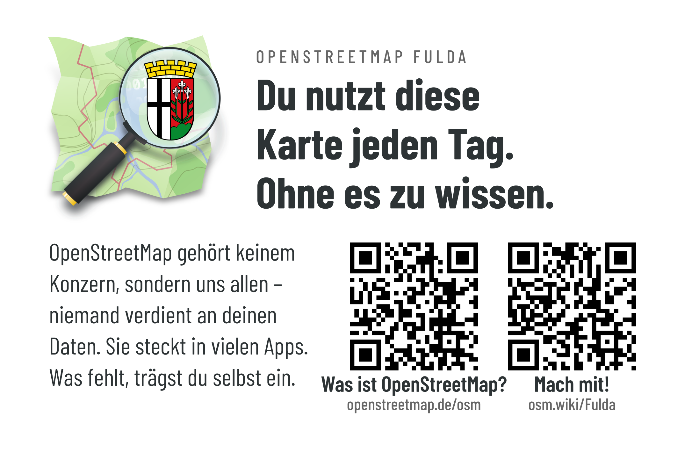
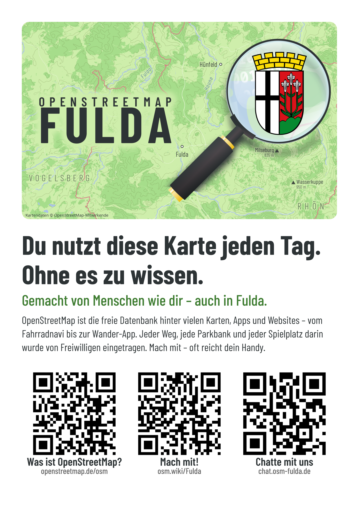
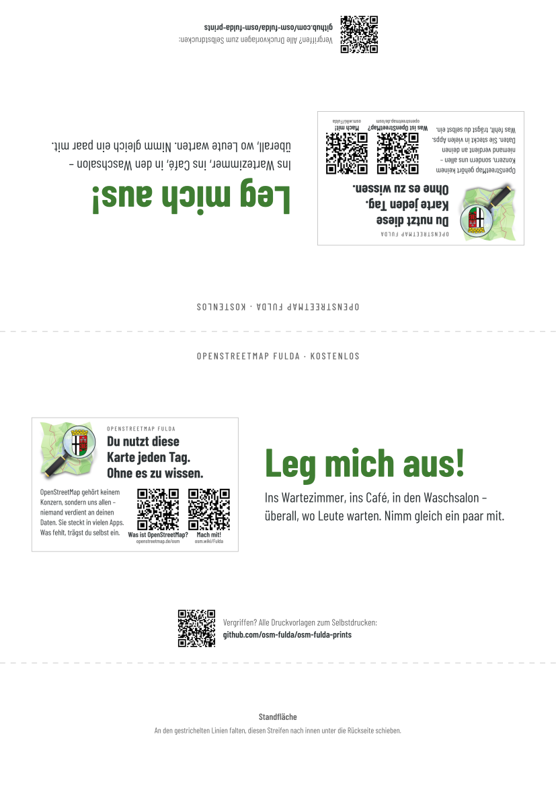
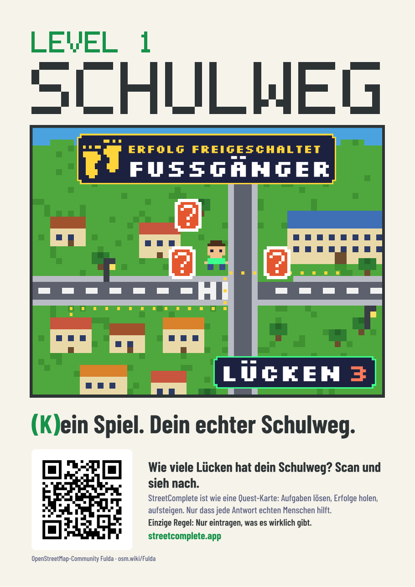
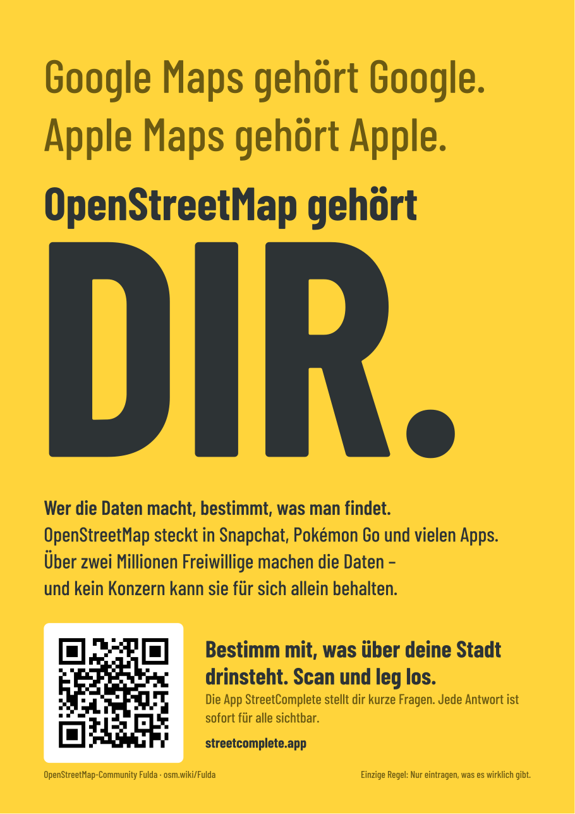
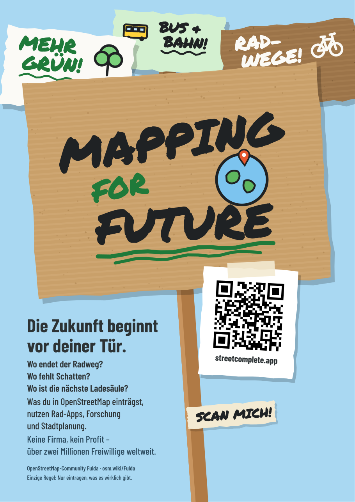
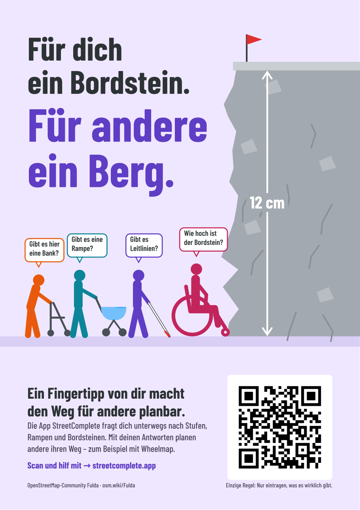

# OSM Fulda – Drucksachen

Druckvorlagen für [OpenStreetMap Fulda](https://wiki.openstreetmap.org/wiki/Fulda), im Stil des
OSM-Fulda-Titelbilds (Schrift *Barlow Condensed*, Textfarbe `#2d3335`). Alles wird aus Skripten gebaut.

## Infostand und allgemein

| [Mitmachkarte](mitmachkarte/) | [Infokarte](infokarte/) | [Aushang](aushang/) | [Aufsteller](aufsteller/) |
|:---:|:---:|:---:|:---:|
| <br> |  |  |    |
| Visitenkarte 85×55, doppelseitig: vorne Titelbild, hinten 6 QR-Codes (Info, Wiki, Matrix, StreetComplete, OSMapp, Panoramax). Für Leute, die schon Interesse haben. | Visitenkarte 85×55, einseitig, zum Liegenlassen (Wartezimmer …): Logo, Aufhänger, 2 QR-Codes. | A5, eine Seite. Für Pinnwand und Schwarzes Brett einseitig drucken, für Glasscheiben beidseitig (dann von innen und außen lesbar). | Drei Tischaufsteller, je einer vor den Stapel: „Steck mich ein!“, „Häng mich auf!“, „Leg mich aus!“. A4, zum Dreieck gefaltet, mit QR-Code zu diesem Repo. |
| [`mitmachkarte-a4.pdf`](mitmachkarte/mitmachkarte-a4.pdf) | [`infokarte-a4.pdf`](infokarte/infokarte-a4.pdf) | [`aushang-a4.pdf`](aushang/aushang-a4.pdf) | [`aufsteller-a4.pdf`](aufsteller/aufsteller-a4.pdf) (3 Seiten) |

## Schulen

Vier Aushänge A4, je für eine Zielgruppe. Die Schülervertretung wählt aus, was zu ihrer Schule passt.
Zielgruppen, Regeln und Hintergründe: [`aushang-schule/README.md`](aushang-schule/README.md).

| Pixel – Gamer | Gelb – Politik | Pappe – Umwelt | Sozial – Barrierefreiheit |
|:---:|:---:|:---:|:---:|
|  |  |  |  |
| [`pixel.pdf`](aushang-schule/aushang-schule-pixel.pdf) | [`gelb.pdf`](aushang-schule/aushang-schule-gelb.pdf) | [`pappe.pdf`](aushang-schule/aushang-schule-pappe.pdf) | [`sozial.pdf`](aushang-schule/aushang-schule-sozial.pdf) |

## Merch

| [Shirts](shirt/) |
|:---:|
|  |
| Motive für den DTF-Druck. Details, Druckgrenzen und Daten: [`shirt/README.md`](shirt/README.md). |

`gemeinsam/` enthält, was alle nutzen: `druck.py` (Schrift, QR, Logo, URLs), `make_a4.py` (Druckbogen),
Schriften, Logo und Titelbild.

## Bauen

```sh
python3 mitmachkarte/make_mitmachkarte.py
python3 infokarte/make_infokarte.py
python3 aushang/make_aushang.py
python3 aufsteller/make_aufsteller.py   # zuletzt: nimmt die Vorschaubilder der anderen
for f in aushang-schule/make_*.py; do python3 "$f"; done
shirt/quelle/build.sh                   # braucht zusätzlich ImageMagick (magick)
```

Braucht: Python 3 mit `qrcode`, `fonttools`, `Pillow`; `rsvg-convert` (librsvg); optional `gs`
(Ghostscript – komprimiert die Bögen von ~18 MB auf ~2 MB). Zum Prüfen der Codes: `zbarimg`.
Die Schriften werden aus `gemeinsam/fonts/` geladen, installieren ist nicht nötig.

Texte, Labels und URLs stehen jeweils oben im Skript, gemeinsame URLs in `gemeinsam/druck.py`.

**Achtung:** Die Skripte überschreiben die SVGs. Wer eine SVG in Inkscape nachbearbeitet, baut den
Bogen danach nur noch mit `gemeinsam/make_a4.py` (siehe Kopf der Datei). Für Inkscape vorher
`gemeinsam/fonts/*.ttf` nach `~/.local/share/fonts/` kopieren.

## Drucken

- Immer **100 % / tatsächliche Größe**, nie „an Seite anpassen“.
- **Visitenkarten** (A4 hoch): Duplex **an langer Kante spiegeln**. 10 Karten pro Bogen.
- **Aushang** (A4 quer, 2× A5): Pinnwand / Schwarzes Brett: nur Seite 1 drucken. Glasscheibe:
  beide Seiten, Duplex **an kurzer Kante**; vorher einen Bogen testen.
- **Schul-Aushänge** (A4 hoch, einseitig): normales Papier reicht, auch als Schwarzweiß-Kopie.
- Dicker Karton (> ~105 g/m²) wird vom Drucker oft nicht automatisch gewendet → manuell:
  erst Seite 1, Stapel wenden, dann Seite 2.
- **Aufsteller** (A4 hoch, einseitig, 3 Seiten): an den gestrichelten Linien falten, unteren Streifen
  als Standfläche nach innen unter die Rückseite schieben. Mind. 160 g/m², sonst kippt er.
- Fürs Fenster mind. 160–200 g/m², sonst scheint die Rückseite durch.

## Schneiden

Die Karten liegen ohne Abstand aneinander – ein Schnitt pro Kante. Die **Vorderseite** hat
durchgehende hellgraue Haarlinien über den ganzen Bogen, sie bleiben nach jedem Schnitt sichtbar.
**Mit der Vorderseite nach oben schneiden**, Klinge genau auf die Linie. Die Rückseite hat
absichtlich keine Linien (Duplex-Versatz von 1–2 mm würde sie auf die Karte schieben); die
schwarzen Randmarken dort zeigen gegen das Licht, wie weit die Rückseite versetzt ist.

## Lizenzen

- Schrift Barlow Condensed: SIL Open Font License, siehe `gemeinsam/fonts/OFL.txt`.
- Schrift IBM Plex Mono (Shirt „Mapper“): SIL Open Font License, siehe `gemeinsam/fonts/OFL-IBMPlexMono.txt`.
- Schrift Silkscreen (Pixel-Aushang): SIL Open Font License, siehe `gemeinsam/fonts/OFL-Silkscreen.txt`.
- Schrift Permanent Marker (Pappschild-Aushang): Apache License 2.0, siehe `gemeinsam/fonts/LICENSE-PermanentMarker.txt`.
- Kartendaten im Titelbild und im Shirt-Stadtplan: © OpenStreetMap-Mitwirkende, ODbL.
