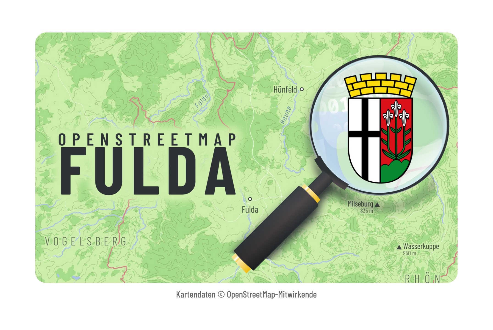
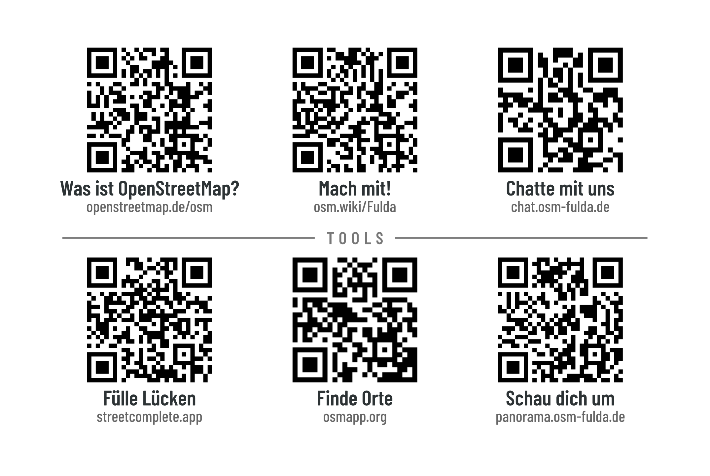
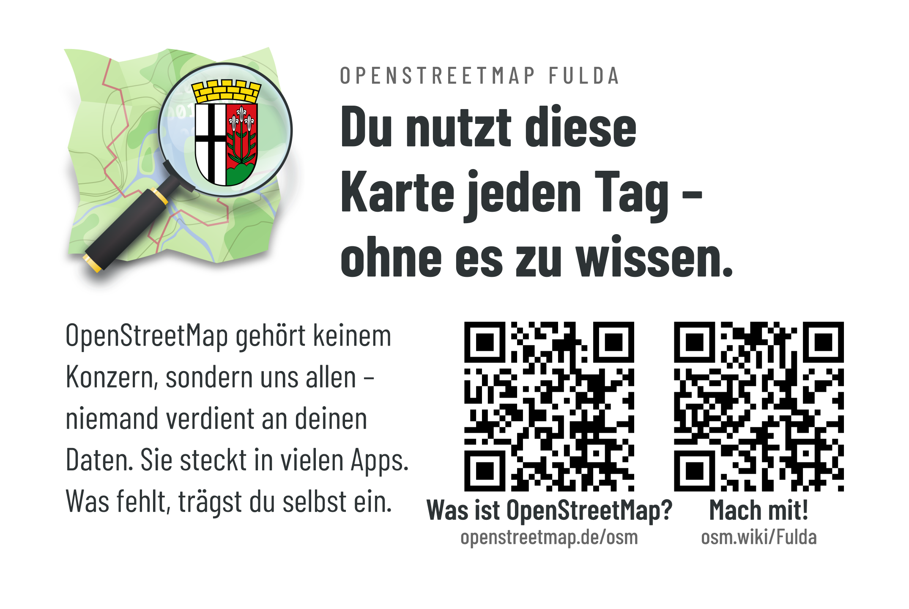
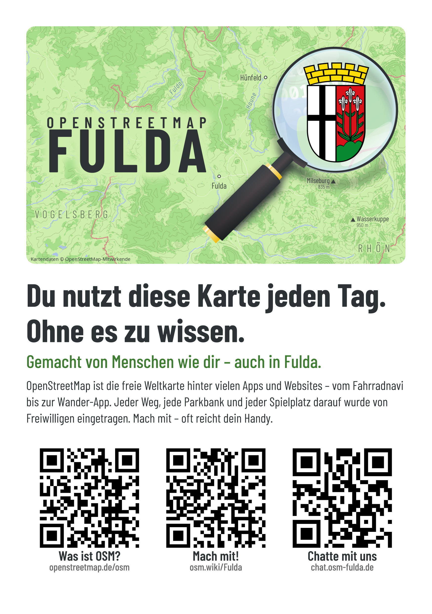
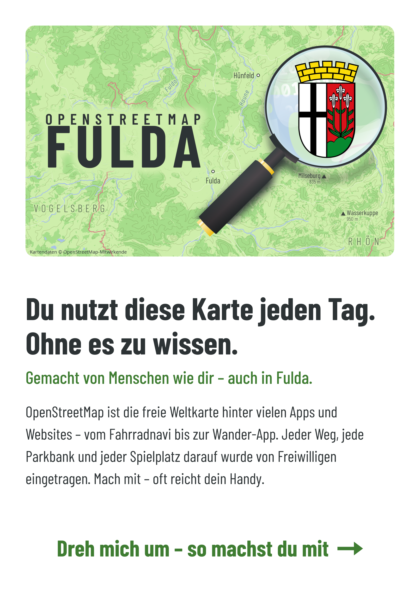
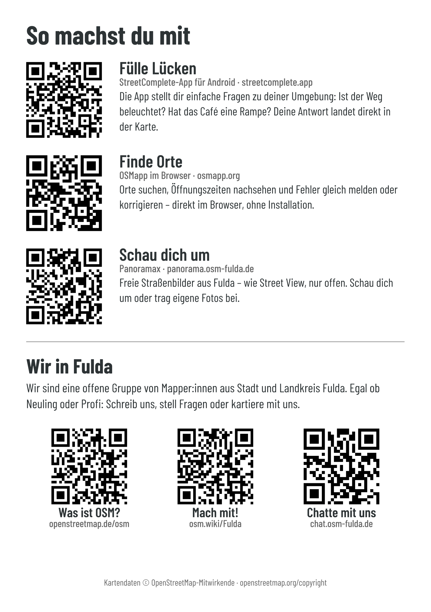
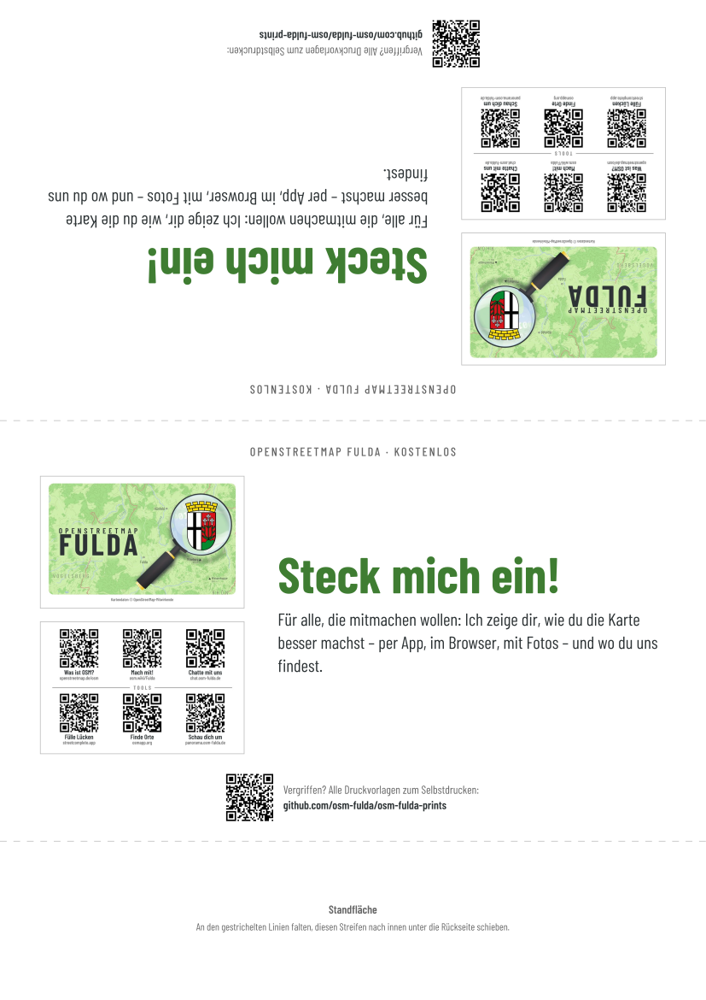
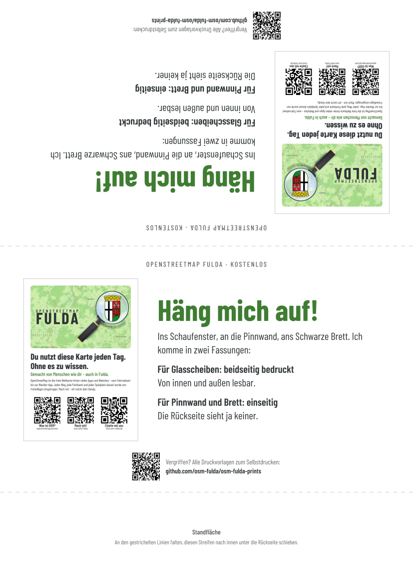
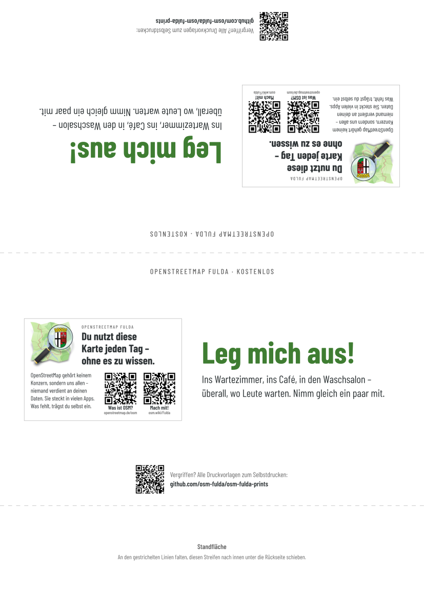

# OSM Fulda – Drucksachen

Visitenkarten, Aushang, Flyer und Tischaufsteller für [OpenStreetMap Fulda](https://wiki.openstreetmap.org/wiki/Fulda),
im Stil des OSM-Fulda-Titelbilds (Schrift *Barlow Condensed*, Textfarbe `#2d3335`).

| Ordner | Vorschau | Was | Druckdatei |
|---|---|---|---|
| `mitmachkarte/` | <br> | Visitenkarte 85×55, doppelseitig: vorne Titelbild, hinten 6 QR-Codes (Info, Wiki, Matrix, StreetComplete, OSMapp, Panoramax). Für Leute, die schon Interesse haben. | [`mitmachkarte-a4.pdf`](mitmachkarte/mitmachkarte-a4.pdf) |
| `infokarte/` |  | Visitenkarte 85×55, einseitig, zum Liegenlassen (Wartezimmer …): Logo, Aufhänger, 2 QR-Codes. | [`infokarte-a4.pdf`](infokarte/infokarte-a4.pdf) |
| `aushang/` |  | A5, eine Seite. Für Pinnwand und Schwarzes Brett einseitig drucken, für Glasscheiben beidseitig (dann von innen und außen lesbar). | [`aushang-a4.pdf`](aushang/aushang-a4.pdf) |
| `flyer/` |   | A5, immer zweiseitig: vorne wie der Aushang, aber ohne QR-Codes; hinten „So machst du mit“ mit allen Codes (Tools, Info, Wiki, Chat). Zum Mitnehmen, auch Vorlage für einen Profidruck. | [`flyer-a4.pdf`](flyer/flyer-a4.pdf) |
| `aufsteller/` |    | Drei Tischaufsteller für den Infostand, je einer vor den Stapel: „Steck mich ein!“ (Mitmachkarte), „Häng mich auf!“ (Aushang), „Leg mich aus!“ (Infokarte). A4 hoch, zum Dreieck gefaltet, von beiden Seiten lesbar; mit QR-Code zu diesem Repo, falls etwas vergriffen ist. | [`aufsteller-a4.pdf`](aufsteller/aufsteller-a4.pdf) (3 Seiten) |
| `gemeinsam/` | | `druck.py` (Schrift, QR, Logo, URLs), `make_a4.py` (Druckbogen), Schriften, Logo, Titelbild | – |

## Bauen

```sh
python3 mitmachkarte/make_mitmachkarte.py
python3 infokarte/make_infokarte.py
python3 aushang/make_aushang.py
python3 flyer/make_flyer.py
python3 aufsteller/make_aufsteller.py   # zuletzt: nimmt die Vorschaubilder der anderen
```

Braucht: Python 3 mit `qrcode`, `fonttools`, `Pillow`; `rsvg-convert` (librsvg); optional `gs`
(Ghostscript – komprimiert die Bögen von ~18 MB auf ~2 MB). Zum Prüfen der Codes: `zbarimg`.
Die Schriften werden aus `gemeinsam/fonts/` geladen, installieren ist nicht nötig.

Texte, Labels und URLs stehen jeweils oben im Skript, gemeinsame URLs in `gemeinsam/druck.py`.

**Achtung:** Die Skripte überschreiben die SVGs. Wer eine SVG in Inkscape nachbearbeitet, baut den
Bogen danach nur noch mit `gemeinsam/make_a4.py` (siehe Kopf der Datei). Für Inkscape vorher
`gemeinsam/fonts/*.ttf` nach `~/.local/share/fonts/` kopieren.

## Drucken

- Immer **100 % / tatsächliche Größe**, nie „an Seite anpassen“.
- **Visitenkarten** (A4 hoch): Duplex **an langer Kante spiegeln**. 10 Karten pro Bogen.
- **Aushang** (A4 quer, 2× A5): Pinnwand / Schwarzes Brett: nur Seite 1 drucken. Glasscheibe:
  beide Seiten, Duplex **an kurzer Kante**; vorher einen Bogen testen.
- **Flyer** (A4 quer, 2× A5): immer Duplex **an kurzer Kante**.
- Dicker Karton (> ~105 g/m²) wird vom Drucker oft nicht automatisch gewendet → manuell:
  erst Seite 1, Stapel wenden, dann Seite 2.
- **Aufsteller** (A4 hoch, einseitig, 3 Seiten): an den gestrichelten Linien falten, unteren Streifen
  als Standfläche nach innen unter die Rückseite schieben. Mind. 160 g/m², sonst kippt er.
- Fürs Fenster mind. 160–200 g/m², sonst scheint die Rückseite durch.

## Schneiden

Die Karten liegen ohne Abstand aneinander – ein Schnitt pro Kante. Die **Vorderseite** hat
durchgehende hellgraue Haarlinien über den ganzen Bogen, sie bleiben nach jedem Schnitt sichtbar.
**Mit der Vorderseite nach oben schneiden**, Klinge genau auf die Linie. Die Rückseite hat
absichtlich keine Linien (Duplex-Versatz von 1–2 mm würde sie auf die Karte schieben); die
schwarzen Randmarken dort zeigen gegen das Licht, wie weit die Rückseite versetzt ist.

## Lizenzen

- Schrift Barlow Condensed: SIL Open Font License, siehe `gemeinsam/fonts/OFL.txt`.
- Kartendaten im Titelbild: © OpenStreetMap-Mitwirkende, ODbL.
