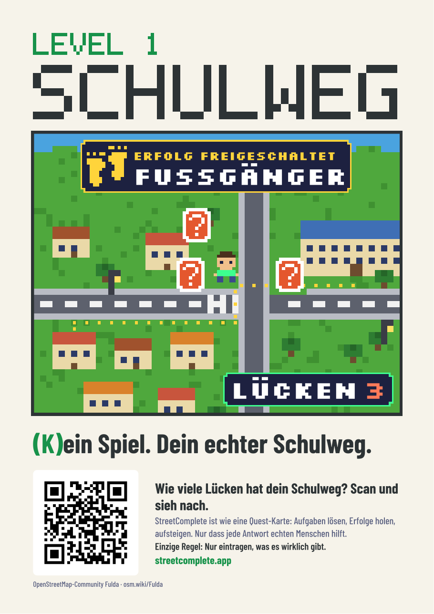
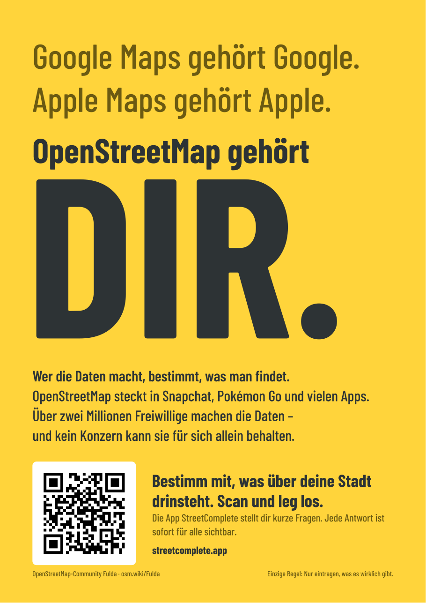
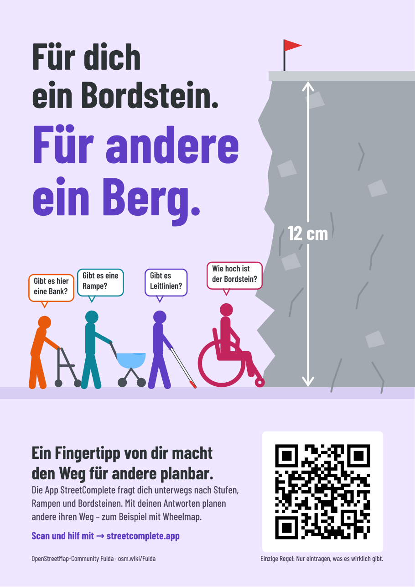

# Aushänge für Schulen

Vier Aushänge A4 hoch fürs Schwarze Brett. Jeder spricht eine Gruppe von Schülerinnen und Schülern an,
mit demselben Aufbau, aber einem eigenen Motiv. Die Schülervertretung wählt aus, was zu ihrer Schule passt.

| | Zielgruppe | Was sie antreibt | Aufhänger | Druckdatei |
|---|---|---|---|---|
|  | Gamer, eher jüngere | Spielen, Fortschritt, Sammeln | „Level 1: Schulweg“, Spielbild mit Lücken-Zähler und Erfolg „Fußgänger“ | [`aushang-schule-pixel.pdf`](aushang-schule-pixel.pdf) |
|  | Ältere, Interesse an Politik | Mitbestimmung, Macht über Daten, Big Tech | „Google Maps gehört Google. … OpenStreetMap gehört DIR.“ | [`aushang-schule-gelb.pdf`](aushang-schule-gelb.pdf) |
|  | Umweltbewusste | etwas bewirken, Belege statt Meinung | Demo-Pappschild „Mapping for Future“ | [`aushang-schule-pappe.pdf`](aushang-schule-pappe.pdf) |
|  | sozial Engagierte | anderen helfen | „Für dich ein Bordstein. Für andere ein Berg.“ | [`aushang-schule-sozial.pdf`](aushang-schule-sozial.pdf) |

Aufgeteilt ist nach Interessen, nicht nach Geschlecht. Eine eigene „Mädchen-Fassung“ wäre Klischee;
Themen wie Barrierefreiheit oder ein sicherer Heimweg sprechen viele an, ohne „für Mädchen“ draufzuschreiben.

## Inhaltliche Regeln

- **Ein QR-Code, und zwar zu StreetComplete** (`https://streetcomplete.app/`). Jugendliche scannen,
  wenn sie etwas entdecken können, nicht wenn es nach Arbeit klingt. StreetComplete zeigt die Lücken
  auf der Karte und lässt sich ohne Konto ausprobieren; hochgeladen wird erst nach der Anmeldung.
- **Kein Chat-Link.** Ein offener Chat mit Erwachsenen gehört nicht auf einen Schulaushang, und
  matrix.to ist für Neue eine hohe Hürde. Fragen laufen über die SV und die Lehrkräfte; die SV kennt
  den Chat aus dem Anschreiben.
- **Nur echte Fragen.** Jede Frage auf einem Aushang stellt StreetComplete wirklich, zum Beispiel
  „Wie hoch ist dieser Bordstein?“ oder „Gibt es hier einen Radweg?“. Auch „Fußgänger“ ist ein echter
  Erfolg der App.
- **„Einzige Regel: Nur eintragen, was es wirklich gibt.“** steht auf jedem Aushang. Beim Pixel-Aushang
  direkt am QR-Code, weil Ranglisten zu schnellen, schlampigen Antworten verleiten können.
- **OpenStreetMap ist eine Datenbank**, keine Karte. In Sprüchen („eine Karte von …“) darf es trotzdem
  „Karte“ heißen.
- **Alter:** Ein OSM-Konto gibt es ab 16 selbst, mit 13–15 legt es ein Elternteil an, unter 13 nicht
  ([Nutzungsbedingungen der OSMF](https://osmfoundation.org/wiki/Terms_of_Use), „Use by minors“).
  Das gehört nicht auf den Aushang, aber ins Gespräch mit der Schule.

## Gestaltungsregeln

- **Lesereihenfolge mit höchstens vier Blöcken:** Titel → Bild → Aufforderung mit QR-Code → Fußzeile.
  Alles, was zum Bild gehört (Erfolg, Zähler, Sprechblasen), liegt im Bild.
- **Feste Zeilenumbrüche nach Sinn** statt automatischem Umbruch, keine einzelnen Wörter in der letzten Zeile.
- **QR-Code** mit weißer Ruhezone von 4 Modulen (ISO/IEC 18004). `common.qr_block` rechnet sie aus der
  Modulgröße aus. Beim Sozial-Aushang steht der Code rechts unten, wo die Leserichtung endet.
- **Kontrast nach WCAG:** Fließtext mindestens 4,5:1, große Schrift und Grafik mindestens 3:1.
- **Pixel-Aushang:** ein Grundpixel `U` = 0,75 mm; jedes Pixel ist ein ganzes Vielfaches davon
  (Karte ×4, Figuren ×2, Schrift ×1/×2). Der Titel nutzt eine eigene 5×7-Pixelschrift im Skript
  (bündig, lesbares W), Silkscreen nur im Spielbild.
- **Wenig Toner:** helle Hintergründe. Die dunkle Pixel-Fassung gibt es nur auf Wunsch:
  `python3 make_pixel.py dunkel`.

## Dateien

| Datei | Inhalt |
|---|---|
| `common.py` | gemeinsame Bausteine: Text, QR-Feld unten mit Fußzeile, Seite, `build()` |
| `make_pixel.py` | Pixel-Aushang (helle Fassung; `dunkel` als Argument) |
| `make_gelb.py` | gelber Aushang, nur Typografie |
| `make_pappe.py` | Demo-Szene mit Pappschildern, Filzstift-Schrift Permanent Marker |
| `make_sozial.py` | Fels-Bordstein mit vier Menschen und Sprechblasen |

Bauen: `for f in make_*.py; do python3 "$f"; done`. Jedes Skript prüft, dass sich keine Texte
überlagern, und bricht sonst mit einer Meldung ab.

Fakten auf den Aushängen, Stand November 2026: OSM-Daten stecken in Snapchat (Snap Map, mit Mapbox),
Pokémon Go, Komoot und vielen anderen Apps; Minecraft nur über das Projekt „Build the Earth“.
Über zwei Millionen Menschen haben an OpenStreetMap mitgearbeitet. Wheelmap nutzt OpenStreetMap.
