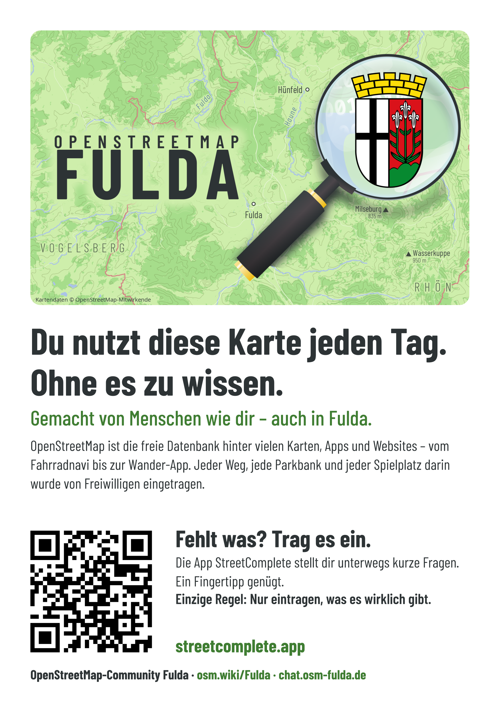
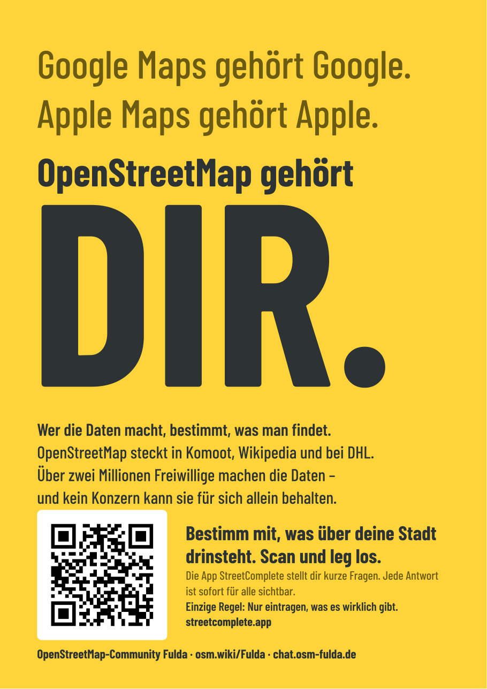
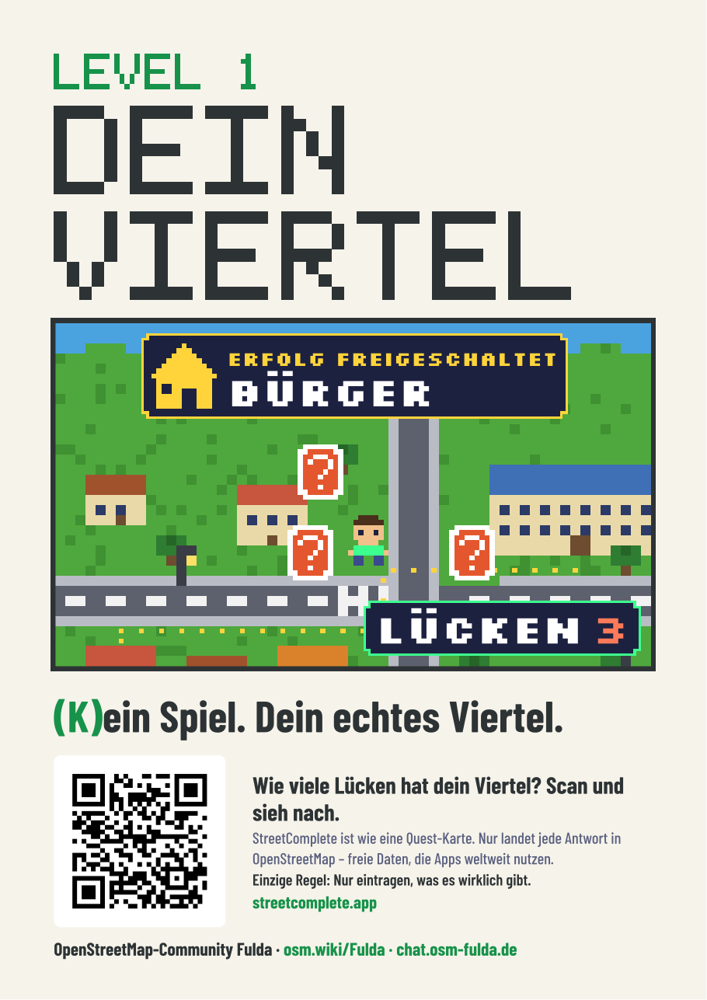
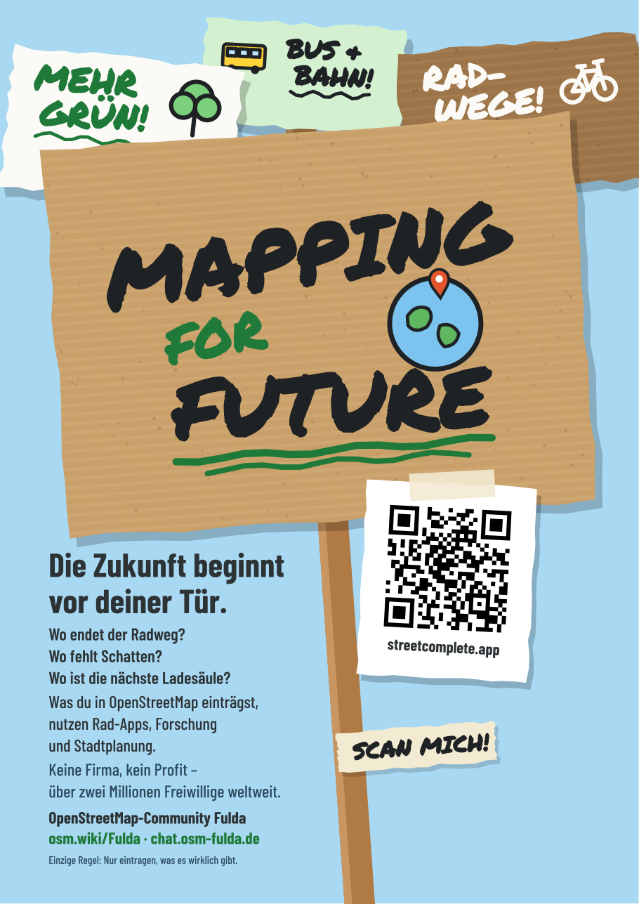
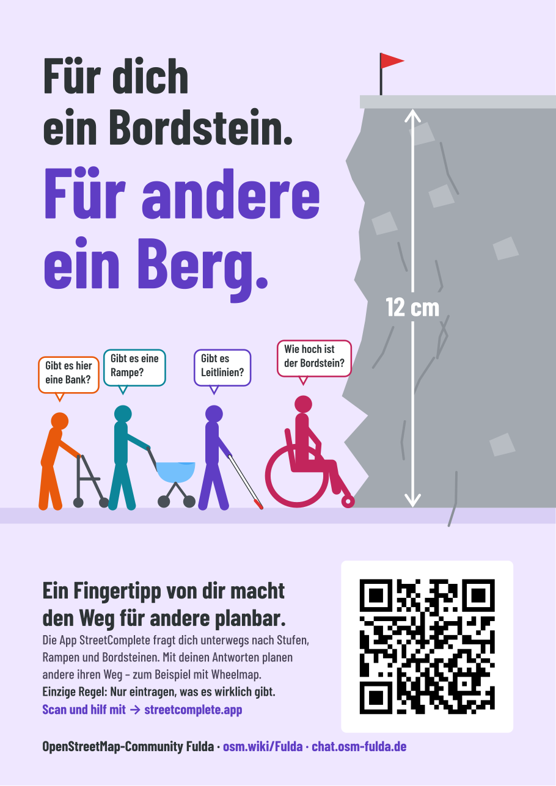

# Aushänge

Fünf Aushänge fürs Schwarze Brett, die Pinnwand und das Schaufenster. Jeder spricht eine Gruppe an,
alle haben denselben Aufbau. Am Stand liegen sie hinter dem Aufsteller „Häng mich auf!“; wer einen
mitnimmt, sucht sich das Motiv aus, das zu den Leuten an seinem Ort passt.

Endformat **137 × 194 mm** (Seitenverhältnis A5), zwei pro A4-Bogen mit Schnittmarken. Einseitig.

| | Motiv | Zielgruppe | Was sie antreibt | Aufhänger | Druckbogen |
|---|---|---|---|---|---|
|  | Klassisch | alle | – | „Du nutzt diese Karte jeden Tag. Ohne es zu wissen.“, Titelbild | [`aushang-klassisch-a4.pdf`](aushang-klassisch-a4.pdf) |
|  | Gelb | politisch Interessierte | Mitbestimmung, Macht über Daten, Big Tech | „Google Maps gehört Google. … OpenStreetMap gehört DIR.“ | [`aushang-gelb-a4.pdf`](aushang-gelb-a4.pdf) |
|  | Pixel | Gamer, „ältere Jüngere“ | Spielen, Fortschritt, Sammeln | „Level 1: Dein Viertel“, Spielbild mit Lücken-Zähler und Erfolg „Bürger“ | [`aushang-pixel-a4.pdf`](aushang-pixel-a4.pdf) |
|  | Pappe | Umweltbewusste | etwas bewirken, Belege statt Meinung | Demo-Pappschild „Mapping for Future“ | [`aushang-pappe-a4.pdf`](aushang-pappe-a4.pdf) |
|  | Sozial | sozial Engagierte | anderen helfen | „Für dich ein Bordstein. Für andere ein Berg.“ | [`aushang-sozial-a4.pdf`](aushang-sozial-a4.pdf) |

Aufgeteilt ist nach Interessen, nicht nach Alter oder Geschlecht. Die Motive gibt es auch als
Karten zum Liegenlassen: [`../motivkarten/`](../motivkarten/).

## Inhaltliche Regeln

- **Ein QR-Code, und zwar zu StreetComplete** (`https://streetcomplete.app/`, Android und iPhone),
  über die Weiterleitung `go.osm-fulda.de/a/<motiv>` (siehe Haupt-README, „QR-Codes“).
  Gescannt wird, wenn man etwas entdecken kann, nicht wenn es nach Arbeit klingt. StreetComplete
  zeigt die Lücken auf der Karte und lässt sich ohne Konto ausprobieren.
- **Die Community steht als Text in der Fußzeile** (Wiki und Chat), groß genug zum Abtippen, aber
  ohne zweiten QR-Code – ein zweiter Code würde vom Einstieg ablenken.
- **Nur echte Fragen und Erfolge.** Jede Frage auf einem Aushang stellt StreetComplete wirklich,
  zum Beispiel „Wie hoch ist der Bordstein?“. „Bürger“ ist ein echter Erfolg der App.
- **„Einzige Regel: Nur eintragen, was es wirklich gibt.“** steht auf jedem Aushang, im Text am QR-Code.
- **OpenStreetMap ist eine Datenbank**, keine Karte. In Sprüchen („Du nutzt diese Karte …“) darf es
  trotzdem „Karte“ heißen.

## Gestaltungsregeln

- **Lesereihenfolge mit höchstens vier Blöcken:** Titel → Bild → Aufforderung mit QR-Code → Fußzeile.
  Alles, was zum Bild gehört (Erfolg, Zähler, Sprechblasen), liegt im Bild.
- **Feste Zeilenumbrüche nach Sinn** statt automatischem Umbruch, keine einzelnen Wörter in der letzten Zeile.
- **QR-Code** mit weißer Ruhezone von 4 Modulen (ISO/IEC 18004). `common.qr_block` rechnet sie aus der
  Modulgröße aus. Beim Sozial-Aushang steht der Code rechts unten, wo die Leserichtung endet.
- **Kontrast nach WCAG:** Fließtext mindestens 4,5:1, große Schrift und Grafik mindestens 3:1.
- **Fußzeile:** Name dunkel, Adressen in der Akzentfarbe des Blatts, gedruckt gut 3,5 mm hoch.
- **Pixel-Aushang:** ein Grundpixel `U` = 0,75 mm; jedes Pixel ist ein ganzes Vielfaches davon
  (Karte ×4, Figuren ×2, Schrift ×1/×2). Der Titel nutzt eine eigene 5×7-Pixelschrift im Skript,
  Silkscreen nur im Spielbild.
- **Wenig Toner:** helle Hintergründe. Die dunkle Pixel-Fassung gibt es nur auf Wunsch:
  `python3 make_pixel.py dunkel`.

## Dateien

| Datei | Inhalt |
|---|---|
| `make_klassisch.py` | klassischer Aushang (gestaltet auf A5, eigenes Skript) |
| `common.py` | Bausteine der vier anderen: Text, QR-Feld unten, Fußzeile, Seite, `build()` (Bogen) |
| `make_gelb.py` | gelber Aushang, nur Typografie |
| `make_pixel.py` | Pixel-Aushang (helle Fassung; `dunkel` als Argument) |
| `make_pappe.py` | Demo-Szene mit Pappschildern, Filzstift-Schrift Permanent Marker |
| `make_sozial.py` | Fels-Bordstein mit vier Menschen und Sprechblasen |

Gelb, Pixel, Pappe und Sozial werden auf A4 (210 × 297) gezeichnet und für den Bogen verkleinert;
die Zeichnungen nutzen auch die Motivkarten. Den Bogen baut `gemeinsam/make_a4.py` (`a5_two_up`).
Jedes Skript prüft, dass sich keine Texte überlagern, und bricht sonst mit einer Meldung ab.

Bauen: `for f in make_*.py; do python3 "$f"; done`

Fakten auf den Aushängen, Stand November 2026: OSM-Daten stecken in Komoot, Wikipedia und bei DHL
(Sendungsverfolgung und Filialsuche auf dhl.de seit April 2024, laut Presseberichten). Über zwei
Millionen Menschen haben an OpenStreetMap mitgearbeitet. Wheelmap nutzt OpenStreetMap.
