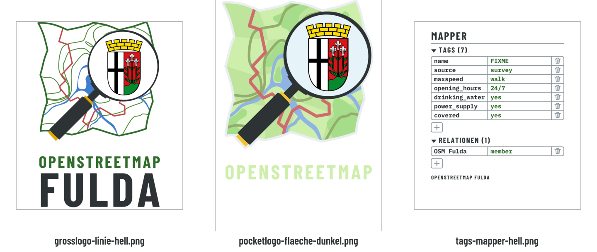

# Shirt-Motive

Motive für den DTF-Druck (Direct to Film). Die PNGs in diesem Ordner lädt man beim Druckdienst hoch;
Quellen und Skripte liegen in `quelle/`.



| Datei | Motiv |
|---|---|
| `grosslogo-linie-hell.png` | großes Logo als flache Linienzeichnung, 27,8 cm breit |
| `pocketlogo-flaeche-dunkel.png` | Brustlogo mit gefüllter Karte für dunkle Shirts, mit heller Kontur |
| `tags-mapper-hell.png` | der Mensch im Shirt als Mapper-„Objekt“ im Stil des iD-Editors, mit `name=FIXME` |

## Bauen

```sh
quelle/build.sh            # Schriften kommen aus ../gemeinsam/fonts
```

Braucht zusätzlich zu den Werkzeugen der Haupt-README ImageMagick (`magick`).

`build.sh` erzeugt auch `pocketlogo-linie-hell` und `tags-fulda-hell`. Die sind nicht in Gebrauch:
PNGs danach löschen und `python3 quelle/vorschau.py ../gemeinsam/fonts` neu laufen lassen.

## Druckgrenzen prüfen

```sh
quelle/check.sh MOTIV.svg BREITE_MM ausgabe.png
```

Rot im Ergebnis: Farbe dünner als 1 mm (der Film kann sich in der Wäsche lösen).
Blau: Lücken schmaler als 0,5 mm (können im Druck zulaufen).

## Daten

Nur das aussortierte Motiv `tags-fulda-hell` nutzt OSM-Daten: den echten Ortsknoten Fulda
(`quelle/fulda-node.overpassql`, Ergebnis `quelle/fulda-node-osm.json`). Neu holen:

```sh
curl --data-urlencode data@fulda-node.overpassql https://overpass-api.de/api/interpreter -o fulda-node-osm.json
```

Daten © OpenStreetMap-Mitwirkende, ODbL.

## Mapper-Namen

`tags.py` erzeugt für jede Zeile in `quelle/mapper-namen.txt` ein eigenes Motiv `tags-mapper-NAME-hell`.
Die Datei und diese Motive enthalten echte Namen und sind per `.gitignore` vom Repo ausgeschlossen.
